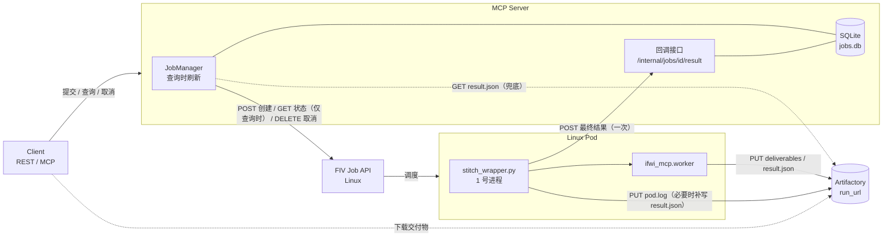
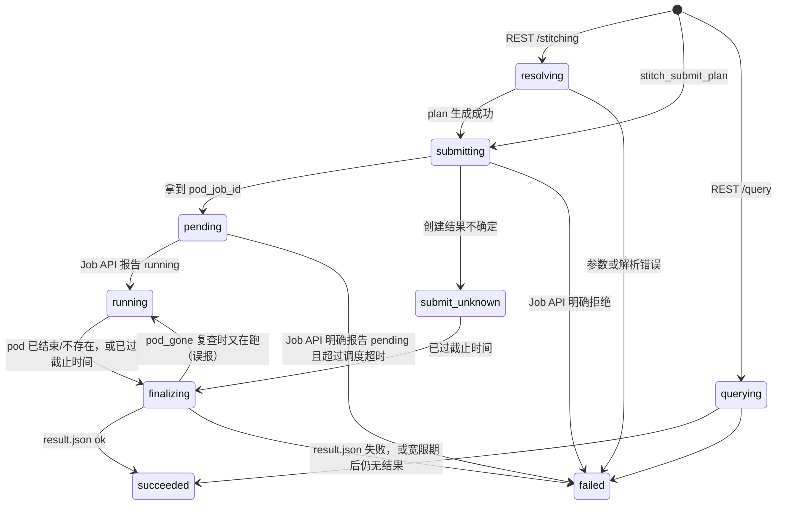
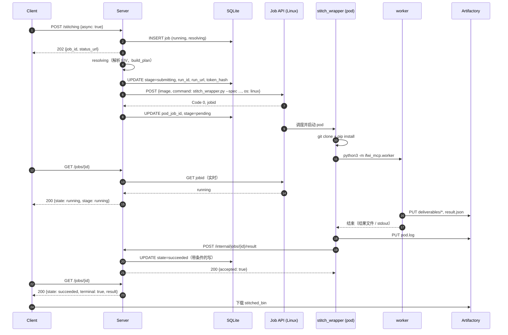
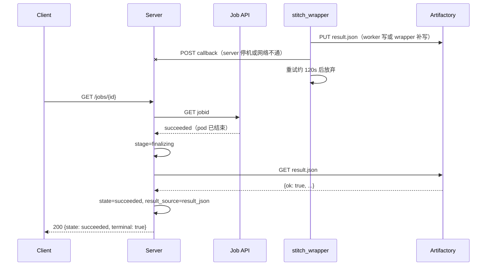

# 远程执行模式：任务状态回传、查询与异常处理设计

> 状态：草案 v3（Design Draft），**已实现并在真实集群上验证**：ifwi-stitching-mcp PR #3（分支 `agents/remote-execution-status-flow-design`，§12.1），wrapper 1.1.1 已合并（cloud-dockerfile #13）并发布为镜像 v1.1.1（§12.2）。2026-10-29 用 Linux Job API 实测发现的 Job API 行为已写入 §5.2、§6.2、§13。范围：`execution.mode = remote` 的完整任务生命周期，stitch pod 为 **Linux pod**；local 执行和 `/query` 的异步任务也纳入同一套任务管理。
> 本文只描述设计，不含代码改动；代码位置以当前 `main` 为准。pod 侧契约见 cloud-dockerfile 的 `docs/stitch_wrapper_contract.md`（protocol 1）。验证原始记录见同目录的 `2026-10-28-remote-execution-validation-records.md`。
> v3 相对 v2 的修订：pod 截止时间改用绝对时间 `deadline_epoch`；调度超时只依据 Job API 明确返回的状态；`gone` 需要两次确认，推断出的失败可以被权威结果覆盖；刷新使用独立线程池；`REMOTE_TERMINATED` 不再一律改判为超时；补充了同步模式的任务 ID、server 模式下的 `stitch_get_deliverables`、提交途中取消、`spec.json` 上传失败、镜像凭据风险和可观测性。

## 0. 摘要

- **结束时回调一次**：pod 直接运行镜像内置的 `/app/stitch_wrapper.py`。wrapper 负责 clone、pip 安装和运行 worker，在任务结束时（无论成功还是失败）**回调 server 一次**；server 收到后立即写入终态，与有没有人查询无关。
- **查询时才刷新，没有后台轮询**：`GET /jobs/{id}` 时，已结束的任务直接返回数据库记录；未结束的任务实时查询一次 Job API，返回 pod 级状态（pending / running）；pod 已结束但没收到回调时，读 `result.json` 兜底。
- **结果来源的优先级**：回调 > `<run_url>/result.json`（worker 写，worker 没写时由 wrapper 补写） > 推断。推断出的失败可以被之后到达的权威结果覆盖。
- **wrapper 覆盖所有失败**：clone 或 pip 失败、worker 崩溃（含 OOM）、超时、pod 被终止，都会主动回调，并带上日志尾部。
- **运行中只有 pod 级状态**：Job API 没有日志接口（用户已确认这个取舍）。
- **持久化（仅 server 模式）**：`JobManager` 加 SQLite（`<cache>/jobs.db`，位于持久卷上）；创建 pod **之前**先写入 `run_id` 和 `run_url`。stdio 模式使用内存存储。
- **接口**：新增回调 `POST /internal/jobs/{id}/result`（每个任务一个 token）、`POST /jobs/{id}/cancel`、`GET /jobs`；`GET /jobs/{id}` 只增加字段；MCP 新增 `stitch_submit_plan / stitch_get_job / stitch_cancel_job / stitch_list_jobs`。
- **异常处理原则**：网络抖动不判失败；创建 pod 结果不确定时不重试；终态以先写入者为准（推断出的失败除外）；每个错误都带 `job_id / run_id / pod_job_id / artifactory_url`。

---

## 1. 背景与问题

现有流程：`POST /stitching {"async": true}` 由 `http_api._post` 启动一个线程，依次执行 `interfaces.stitching` → `executor._execute_remote` → `_create_job` → `_wait_job`（循环 GET，阻塞到终态或超时）→ `_read_remote_result` → `deliverables.fetch`（把交付物下载到 server）。`GET /jobs/{id}` 读的是内存字典 `_JOBS`。pod（Windows）命令是用 `;` 连接的 `git clone; pip install; python -m ifwi_mcp.worker`。

| # | 问题 | 影响 | 位置 |
|---|------|------|------|
| P1 | 任务状态只存在内存 `_JOBS` 中 | 重启或请求打到另一个进程时返回 `JOB_NOT_FOUND`；正在跑的 pod 成为孤儿 | `http_api.py` |
| P2 | 每个远程任务占一个线程，阻塞到 pod 结束 | 无法统一管理和限流 | `executor._wait_job` |
| P3 | 只有 `running/succeeded/failed` | 区分不出等调度和运行中 | `http_api._complete` |
| P4 | 轮询失败一次就判任务失败 | Job API 抖动时误判 | `_wait_job` |
| P5 | `Code != 0` 一律当作 pending | job 被清理后只能等到超时 | `_wait_job` |
| P6 | 创建请求超时直接报错 | pod 可能已创建，重试会产生重复 pod | `_create_job` |
| P7 | 没有 pending 超时 | 资源不足时要等满 1h | `_wait_job` |
| P8 | `result.json` 缺失时只有一种笼统的错误 | 区分不出 clone/pip 失败、worker 被杀、上传失败 | `_read_remote_result` |
| P9 | 不能取消任务 | 提交错了只能等 | — |
| P10 | server 模式下把交付物下载到 server 本地 | 浪费磁盘、暴露 server 路径、结果形状不一致 | `_execute_remote` |
| P11 | MCP `stitch_execute_plan` 同步阻塞，最长 1h | 超出 MCP 客户端的超时 | `server.py` |
| P12 | pod 命令用 `;` 连接，前一步失败仍继续 | 可能运行镜像里的旧 worker；失败原因丢失 | `executor._pod_command` |
| P13 | Linux 区分大小写，runner 只找 `output/` | 厂商工具写到 `Output/`，拼接成功却报 `STITCH_NO_OUTPUT` | `stitch_runner.execute_command` |

---

## 2. 架构与结果来源



| 来源 | 内容 | 权威性 | 失效情形 |
|------|------|--------|----------|
| **回调** | 最终 envelope、日志尾部、退出码、worker commit | **最高**，收到后立即进入终态 | 没配置 `report_base_url`；server 不可达；wrapper 没启动或被 SIGKILL |
| `<run_url>/result.json` | 同一份最终 envelope | 与回调相同 | wrapper 和 worker 都没能写出（镜像拉取失败、节点故障） |
| Job API `GET <endpoint>/<pod_job_id>` | pod 生命周期 | 只说明 pod 是否结束，**不说明拼接是否成功** | pod 结束 12h（`ttlsecondsafterfinished`）后被清理；接口抖动 |

前两个来源都拿不到时，才根据 Job API 推断结果（§6.3）。

**关联键**：`run_id = <plan_id>-<8 位 hex>`，`run_url = <artifactory_repo>/<run_id>`，由 server 生成，**创建 pod 之前写入数据库**，再通过 spec 传给 wrapper。因此即使没拿到 `pod_job_id`，或者 Job API 已经清理了记录，仍然能通过 `run_url` 找到结果。**一个 `run_id` 只对应一次 pod 提交**：只在请求确定没有送达时才重试创建（E5）；Job API 不能自动重启 pod（`restartPolicy=Never` / `backoffLimit=0`，待确认，§13）。如果 pod 被重启过，回调中的 `attempt_id` 会变化，server 只接受第一次回调，并记 warning。

---

## 3. 状态模型

- `state`：**稳定的对外契约**，取值为 `queued | running | succeeded | failed | cancelled`。活跃任务总数达到 `max_active_jobs` 时直接返回 503；远程任务另外受 `max_running_pods` 限制，超出时进入 `queued` 排队（见 §7.1），其余任务一创建就是 `running`。
- `stage`：只用于展示和诊断，以后可能新增取值。
- `terminal` = `state ∈ {succeeded, failed, cancelled}`。**客户端用它判断是否停止轮询。**

| stage | 含义 | 适用 |
|-------|------|------|
| `querying` | 正在执行查询 | query |
| `resolving` | 解析 FIV、生成 plan | REST `/stitching` |
| `queued` | 同时存在的 pod 已达 `max_running_pods`，等待空位；还没有 `run_id`，也没有 pod（`state` 同为 `queued`） | remote |
| `submitting` | `run_id` 已落库，正在调用 Job API 创建 pod | remote |
| `submit_unknown` | 创建结果不确定，没有 `pod_job_id`，只能等回调或 `result.json` | remote |
| `pending` / `running` | Job API 报告的 pod 状态（clone、pip、拼接、上传都算 running） | remote（local 只有 running） |
| `finalizing` | pod 已结束、已不存在或已过截止时间，但还没收到回调；在宽限期内等回调或 `result.json` | remote |
| `done` | 终态 | 全部 |

远程任务的 `stage` **只在收到回调或有人查询时更新**，没人查询时停在 `pending` 是正常的。



图中省略了：**回调**（任何非终态阶段收到回调，都直接进入 `succeeded` 或 `failed`，这是最常见的结束方式）；**取消**（可取消的非终态任务立即变为 `cancelled`，删除 pod 的进度只体现在 `cleanup` 字段中，§8.3）；**推断出的失败被覆盖**（§6.3）。

**兼容性**：原有 `state` 的语义和初始值不变，新增 `cancelled`（只在调用方主动取消时出现）。现有客户端"不是 succeeded/failed 就继续轮询"，建议改用 `terminal`。server 模式下 `404 JOB_NOT_FOUND` 只表示"从未存在或已过保留期"，不会再因为重启出现。

---

## 4. 存储：SQLite JobStore

### 4.1 选型与范围

- **采用 SQLite**：Python 自带，不增加依赖和服务；有事务；可以建索引；放在已有的持久卷上。内存字典重启即丢；每个任务一个 JSON 文件需要自己实现原子写和扫描；Redis/Postgres 对单实例、几十到几百个任务的规模来说运维成本过高。
- **以下情况升级到 Postgres/Redis**：需要多实例或高可用；有外部系统需要直接查询；SQLite 的单写锁成为瓶颈。所有访问都通过 `JobStore` 接口完成（`SqliteJobStore` / `MemoryJobStore`），换存储不需要改上层代码。
- **哪些请求会记录任务**（仅 server 模式，local 和 remote 都算）：`POST /stitching`（非 dry run，同步或异步）、`POST /query` 的异步请求、MCP `stitch_submit_plan / stitch_execute_plan`。同步 `/query` 和 dry run 不记录。
- server 重启时：remote 任务不受影响（pod 照常运行，wrapper 的回调会重试约 120s，之后还有 `result.json` 兜底）；local 任务无法接管，标记为 `JOB_INTERRUPTED`（§8.4）。
- 任务本身**只需要一张 `jobs` 表**，嵌套信息存成 JSON 列。另有一张只追加的 `job_events` 表记录每个任务的历史（§4.2），只用于排查，不参与任何判定，随 `jobs` 一起清理。

### 4.2 表结构

```sql
PRAGMA user_version = 2;          -- schema 版本，用于迁移（1：jobs；2：增加 job_events）

CREATE TABLE IF NOT EXISTS jobs (
    job_id            TEXT PRIMARY KEY,          -- uuid4 hex，也是 wrapper 的 --job-id
    kind              TEXT NOT NULL,             -- 'stitch' | 'query'
    executor          TEXT,                      -- 'remote' | 'local' | NULL（query）
    state             TEXT NOT NULL,             -- queued|running|succeeded|failed|cancelled
    stage             TEXT NOT NULL,
    client_request_id TEXT,                      -- 可选幂等键（§7.1）
    request_hash      TEXT,                      -- 规范化请求参数的 sha256
    created_at        REAL NOT NULL,             -- 墙钟 epoch 秒（重启后仍有效）
    updated_at        REAL NOT NULL,
    finished_at       REAL,
    submitted_at      REAL,                      -- 发出创建 pod 请求之前写入（§4.5）
    deadline_at       REAL,                      -- 得不到 pod 状态时的兜底截止时间（§8.5）
    deadline_extended INTEGER NOT NULL DEFAULT 0,-- deadline_at 是否已延长过（只延长一次）
    finalize_deadline_at REAL,                   -- 收尾宽限期的截止时间（§6.3）
    finalize_reason   TEXT,                      -- 'pod_ended' | 'pod_gone' | 'deadline' | 'submit_unknown'
    last_checked_at   REAL,                      -- 上次查询 Job API 的时间（节流）
    plan_id           TEXT,
    run_id            TEXT UNIQUE,
    run_url           TEXT,
    pod_job_id        TEXT,
    pod_status        TEXT,                      -- Job API 返回的原始 status
    report_token_hash TEXT,                      -- 回调 token 的 sha256，从不存明文
    result_source     TEXT,                      -- 'callback' | 'result_json' | 'inferred' | 'server'
    cleanup_pending   INTEGER NOT NULL DEFAULT 0,-- 终态后仍需删除 pod
    owner             TEXT,                      -- instance_id（为多实例预留）
    request_json      TEXT,                      -- 清洗后的请求参数（不含 token）
    remote_json       TEXT,                      -- {consecutive_errors, degraded, last_error, gone_seen_at, attempt_id, wrapper_version,
                                                 --  worker_commit, durations, pod_log_url, exit_code, signal, superseded_result}
    cleanup_json      TEXT,                      -- {pod_delete: pending|done|failed, attempts, last_error}
    warnings_json     TEXT,
    result_json       TEXT                       -- 终态时的统一 envelope
);
CREATE INDEX IF NOT EXISTS ix_jobs_active  ON jobs(state, deadline_at);
CREATE INDEX IF NOT EXISTS ix_jobs_cleanup ON jobs(cleanup_pending);
CREATE INDEX IF NOT EXISTS ix_jobs_created ON jobs(created_at);
CREATE INDEX IF NOT EXISTS ix_jobs_plan    ON jobs(plan_id);
CREATE UNIQUE INDEX IF NOT EXISTS ux_jobs_idem ON jobs(kind, client_request_id)
    WHERE client_request_id IS NOT NULL;

-- 只追加的事件日志：只用于排查，不参与任何判定
CREATE TABLE IF NOT EXISTS job_events (
    job_id  TEXT NOT NULL,
    at      REAL NOT NULL,       -- 与 jobs.updated_at 相同的墙钟时间
    state   TEXT NOT NULL,       -- 写入后的 state / stage
    stage   TEXT NOT NULL,
    detail  TEXT                 -- 最多 500 字符
);
CREATE INDEX IF NOT EXISTS ix_job_events_job ON job_events(job_id, at);
```

**事件日志**：每次 `mutate()` 在同一个事务里追加事件，所以事件与任务记录不会不一致。

- **状态或阶段变化**：自动记录，例如 `running/pending -> running/finalizing (pod_ended)`；进入终态时附上结果来源和结论，例如 `running/running -> succeeded/done [callback: ok]`。任务创建时记一条 `created`。
- **其他值得排查的事实**：由调用方用 `note(row, text)` 附加：
  - pod 已创建（带 `pod_job_id`）；
  - 收到回调（attempt、wrapper 版本、结果来源和结论，无论是否被采纳）；
  - Job API 开始降级、恢复，第一次报告 not found，返回未知状态；
  - 截止时间被延长；
  - 推断出的失败被覆盖；
  - 每次删除 pod 的结果。
- 不记录每次查询的心跳，避免日志膨胀。
- 清理任务记录时一并删除它的事件（§11）。
- 通过 `GET /jobs/{id}?events=true` 或 `stitch_get_job(job_id, include_events=True)` 查看，最多返回最近 200 条（§7.2）。

### 4.3 使用要点

- **连接**：`journal_mode=WAL`、`synchronous=NORMAL`、`busy_timeout=5000`。全进程共用**一个写连接**（`check_same_thread=False`），由一把 `threading.Lock` 保护**整个事务**；读连接每个线程各一个。"先检查再写入"的操作在持锁状态下用 `BEGIN IMMEDIATE` 包成一个事务（例如提交时的限流计数、幂等检查和 `INSERT`）。
- **终态以先写入者为准**：回调、查询时刷新、取消可能同时到达，都只能通过带条件的写改变状态：
  ```sql
  -- 进入终态：只作用于非终态记录（普通的阶段更新同样带 state IN ('queued','running') 条件）
  UPDATE jobs SET state=?, stage='done', result_json=?, result_source=?, finished_at=?, updated_at=?
   WHERE job_id=? AND state IN ('queued','running');
  -- 唯一的例外：权威结果（回调、result.json）覆盖推断出的失败（§6.3）
  UPDATE jobs SET state=?, result_json=?, result_source=?, updated_at=?
   WHERE job_id=? AND state='failed' AND result_source='inferred';
  ```
  `rowcount == 0` 说明任务已被其他路径结束，当前路径放弃写入。
- **事实类字段无条件写入**：`pod_job_id`、`pod_status`、`cleanup` 等外部已经发生的事实，任务即使已是终态（例如刚被取消）也要写入。只有 `state`、`stage`、`result` 受上面的条件约束。
- **大小上限**：外部响应体最多保留 2KB；`log_tail` 最多 4KB。
- **迁移**：启动时按 `PRAGMA user_version` 顺序执行迁移脚本。
- **不存凭据**：`request_json` 只保留业务字段；回调 token 只存哈希；pod 命令行不入库。

### 4.4 部署与访问边界

- 只有 server 进程读写数据库。运维排查时以只读方式打开：`docker exec -it <container> sqlite3 "file:/data/cache/jobs.db?mode=ro"`，或者用 `.backup` 导出后离线查看。外部系统需要直接连库时，应升级到 Postgres。
- **不能放在 NFS、SMB 等网络盘上，也不能多个进程同时写**（文件锁不可靠，可能损坏数据库）。
- `jobs.db` 在 `IFWI_MCP_CACHE_DIR` 下的持久卷上（Docker 中为 `/data/cache/jobs.db`，`compose.yaml` 把命名卷 `ifwi-mcp-data` 挂在 `/data`）：重建镜像、`up -d --build`、`down` 后再 `up` 都**保留**；`down -v`、`docker volume rm`、`docker run` 没挂 `/data` 时**丢失**。README 需要写明**不要用 `down -v` 做常规重新部署**。
- 以后迁移到 K8s：挂 PVC，单副本，并使用 `strategy: Recreate`（默认的 RollingUpdate 会让新旧两个 pod 同时写同一个文件）。
- 可选环境变量 `IFWI_MCP_JOBS_DB` 指定数据库路径；`cache_cleanup` 不会删除它。即使数据库丢失，结果仍在 Artifactory 的 `run_url` 下，只是不能再通过 `job_id` 查到。

### 4.5 stdio 模式：不写数据库，也不回调

`serve.mode=local` 时使用 **`MemoryJobStore`**，不创建 `jobs.db`：

- 同一台机器上的多个 stdio 进程（例如多个 VS Code 窗口）共用一个 cache 目录。如果共用一个数据库，某个进程的启动处理（§8.4）会把其他进程正在跑的任务误判为中断；要避免这个问题就得引入租约，代价太高。
- pod 访问不到用户本机，所以 `report_url` 为空，远程任务的结果完全靠查询时刷新。
- 异步 MCP 工具在进程存活期间可用，各进程的任务互相不可见；进程退出后任务记录丢失，但结果仍在 Artifactory 上。`MemoryJobStore` 实现同样的"带条件的写"语义（一把锁加一个字典）。

### 4.6 先落库再创建 pod

提交远程任务时严格按以下顺序执行，每一步都先提交事务：

1. `INSERT` 任务记录（`state=running`，`stage=resolving` 或 `submitting`），返回 202。
2. （仅 REST `/stitching`）解析 FIV、生成 plan，写入 `plan_id`。
3. 生成 `run_id`、`run_url` 和回调 token，**在同一个事务里**用带条件的写更新为 `stage=submitting`，同时写入 `run_id, run_url, report_token_hash, submitted_at=now, deadline_at`。**写库失败或 `rowcount=0`（已被取消）时，不创建 pod。**
4. 构造 spec 和命令（§5.2）。需要 `--spec-url` 时，先上传 `<run_url>/spec.json`，上传失败就不创建 pod（E3c）。然后调用 `POST <endpoint>`。
5. 创建成功后，**无条件**写入 `pod_job_id`，再用带条件的写更新为 `stage=pending`：
   - `rowcount=0`（期间被取消）：同步 DELETE 这个 pod（§8.3）。
   - 写 `pod_job_id` 失败（磁盘满、锁超时）：立即把 `pod_job_id` 和 `run_id` 记到 WARNING 日志；在内存中保留，按 1、2、4… 秒的间隔重试最多 60s；仍然失败就 DELETE 这个 pod，并尽力把任务标记为 `INTERNAL_ERROR`。这种情况**不能**按"提交前写库失败"处理。

提交线程到此结束，之后**没有线程追踪这个 pod**。如果 server 在第 3 步和第 5 步之间崩溃，重启后按 `submit_unknown` 处理（§8.4）。

---

## 5. Pod 侧：stitch_wrapper 与回调

> wrapper 实现为 cloud-dockerfile 的 `stitch_wrapper.py`（v1.0.0，分支 `feat/stitch-wrapper`），已打进镜像 `fiv-ubuntu24.04-python3.13:v1.1.0` 并在本地验证（§12.4）。本节只摘要说明 server 需要知道的内容。

### 5.1 为什么需要 wrapper

- **只靠 worker 自己回调不够**：clone 或 pip 失败时 worker 还没启动；worker 崩溃、OOM、被 SIGKILL，或者 pod 被终止时，worker 来不及汇报。wrapper 作为容器的 1 号进程包在 worker 外面，这些情况都能汇报，并带上日志尾部。
- **wrapper 放进镜像，worker 运行时再安装**：wrapper 很少改动；worker 按 `repo_ref` 拉取，改代码不用重新发布镜像。代价是每次运行多约 70s 的 clone 和 pip。worker 稳定后可以也打进镜像（§14）。
- **不复用镜像里的 `/app/main.py`**：它是 fiv-auto-service 的 wrapper，回调格式、整数 `task_id` 和共享 CI token 都与那个服务绑定。两者在镜像中并存。

### 5.2 创建 pod：请求、命令与 spec

**Job API**：Linux 地址 `http://infra-api-fiv-linux.bios-dev-sh-cloud.intel.com/v1/fivportal/job`。请求体参照 cloud-proxy 在生产中的用法：

```json
{"image": "<execution.image>", "command": "<见下>", "os": "linux",
 "activedeadlineseconds": 3600, "ttlsecondsafterfinished": 43200}
```

**命令**：`exec python3 /app/stitch_wrapper.py --job-id <job_id> --spec <spec_token> --report-token <token>`

- 参数值只含 `[A-Za-z0-9_.:/=-]`，不需要转义，P12 也就不存在了。
- **必须以 `exec` 开头**（2026-10-29 实测）：Linux Job API 以 `sh -c "<command>"` 运行命令，这个 `sh` 是 1 号进程，而且不处理 SIGTERM。作为 1 号进程，没有处理器的信号会被直接忽略。不加 `exec` 时 wrapper 是 `pid=6`：删除 pod 时它收不到 SIGTERM，只能等宽限期结束后被 SIGKILL，既没有回调，也没有 `pod.log` 和 `result.json`。加 `exec` 后，`sh` 被 wrapper 替换，wrapper 成为 1 号进程，删除 pod 后 1 秒内就会回调 `REMOTE_TERMINATED`。
- 回调 token **只能放在命令行里**：Swagger 中 `Job_Req` 只有 `image` 和 `command`，没有 env 字段。token 只能给这一个任务提交结果，并且会过期，泄露的影响有限。Job API 以后支持 env 时就改为通过 env 传。

**spec**：JSON 的编码方式与 `plan.encode_plan` 相同（`base64url(zlib(JSON))`，不带填充），**不含任何凭据**。

| 字段 | 取值 |
|------|------|
| `spec_version` / `job_id` / `run_id` / `run_url` | `1` / 任务 ID / §2 |
| `report_url` | `<execution.report_base_url>/internal/jobs/<job_id>/result`；没配置 `report_base_url`，或者在 stdio 模式下，为 `null` |
| `worker.repo_url` / `worker.repo_ref` | 来自配置；生产环境建议 `repo_ref` 固定为 commit SHA。`worker.module` 不传（默认 `ifwi_mcp.worker`） |
| `timeouts.budget_seconds` | 等于 `activedeadlineseconds`（`execution.timeout_seconds`） |
| `timeouts.deadline_epoch` | **新增**（需要 wrapper 支持，§12.2）：`submitted_at + timeout_seconds - 30`（30s 为时钟偏差余量），墙钟 epoch 秒（§8.5） |
| 其他 `timeouts.*`、`tls_verify` | 一般不传，使用 wrapper 的默认值 |
| `plan` | plan 对象 |

**命令长度**：带 2 个 ingredient 时 spec 令牌约 0.8KB，Job API 的上限未知（§13）。spec 令牌超过 `max_inline_spec_bytes`（4096）时，先上传到 `<run_url>/spec.json`，命令改用 `--spec-url`。

### 5.3 wrapper 的行为

1. 解析参数和 spec。不合法时退出码为 2；能解析出 `report_url` 时回调 `WRAPPER_SPEC_INVALID`。
2. clone（最多 3 次）、pip install（最多 2 次）。`repo_ref` 是 40 位 SHA 时改用 `git fetch <sha>`。
3. 以独立进程组运行 `python3 -m ifwi_mcp.worker --plan-b64 ... --upload-url <run_url>`。通过环境变量传入 `IFWI_STITCH_RESULT_FILE`、`IFWI_MCP_EXEC_TIMEOUT`（按剩余预算计算）、`IFWI_STITCH_DEADLINE_EPOCH`、`IFWI_STITCH_JOB_ID`、`IFWI_STITCH_RUN_ID` 和凭据；去掉 `IFWI_MCP_EXEC_MODE` 和 `IFWI_MCP_SERVER_MODE`。
4. 看门狗：到达截止时间（`min(启动时间 + budget, deadline_epoch) - reserve`）或收到 SIGTERM 时，向 worker 发 SIGTERM，等待后再发 SIGKILL。
5. 确定最终结果，按优先级取：worker 的结果文件 → worker stdout 最后一行的 envelope → wrapper 自己生成的错误。
6. 上传 `<run_url>/pod.log`；`result.json` 不存在时补写（**绝不覆盖** worker 写的）。
7. **回调一次**。被终止，或者离截止时间不足 90s 时，**先回调、后上传**。
8. 退出码：0 表示 `ok=true`，1 表示失败，2 表示调用不合法。所以 Job API 显示的 pod 成败与拼接成败一致。

wrapper 生成的错误码见 §8.6（worker 的错误码原样透传）。这些错误的 `detail` 都带 `job_id / run_id / step / log_tail`（pod.log 最后 4KB），可能还有 `exit_code / signal / pod_log_url`。

### 5.4 回调协议

```
POST <report_url>          （/internal/jobs/<job_id>/result）
Authorization: Bearer <report_token>
```

```json
{
  "schema_version": 1, "job_id": "...", "run_id": "...", "attempt_id": "<每个 wrapper 进程一个>",
  "wrapper": {"name": "stitch_wrapper", "version": "1.0.0", "protocol": 1},
  "worker": {"repo_url": "...", "repo_ref": "...", "commit": "<实际 commit>", "module": "ifwi_mcp.worker"},
  "result_source": "worker_file | worker_stdout | wrapper",
  "result": {"ok": true, "data": {}},
  "exit_code": 0, "signal": null, "terminated": false,
  "started_at": "...", "finished_at": "...",
  "durations": {"bootstrap_seconds": 69.5, "worker_seconds": 175.7},
  "pod_log_url": "<run_url>/pod.log", "log_tail": "..."
}
```

- **token**：提交时用 `secrets.token_urlsafe(32)` 生成，数据库只存 `sha256`，server 重启后仍然有效。只能给这一个 `job_id` 提交结果，有效期到 `deadline_at + finalize_grace_seconds + 600`。
- **wrapper 的重试规则**：2xx 停止；除 408、429 以外的 4xx 不再重试；408、429、5xx 和网络错误按 2、4、8、16、30… 秒退避，总时长不超过 120s，并且不超过截止时间前 5s；被终止时最多重试到收到 SIGTERM 后第 25 秒。回调失败不影响结果，因为 `result.json` 已经写好。

### 5.5 worker（ifwi_mcp）需要的改动

| 改动 | 是否必需 |
|------|----------|
| 查找输出目录时不区分大小写（P13），**这是 Linux pod 的前提**。旧工具写 `Output/`、新工具写 `output/`，两种都要支持；Linux 上两个目录可能同时存在，要都查找（先 `output/`，再 `Output/`），取第一个有产物的 | **必需** |
| 在所有出口把最终 envelope 写到 `IFWI_STITCH_RESULT_FILE`（先写临时文件再 rename） | 推荐（wrapper 已经能从 stdout 拿到结果） |
| 收到 SIGTERM 时终止拼接子进程，写出结果后退出：离 `IFWI_STITCH_DEADLINE_EPOCH` 不足 5s 时为 `REMOTE_TIMEOUT`，否则为 `REMOTE_TERMINATED`（外部终止） | 推荐 |
| `result.json` 顶层增加 `schema_version / run_id / finished_at`。server **必须兼容**没有这些字段的裸 envelope | 推荐 |

worker 不需要访问 server，也不需要知道回调地址。

### 5.6 镜像中的凭据

镜像 `amr-registry.caas.intel.com/fia-cloud/fiv-ubuntu24.04-python3.13:v1.1.1`（v1.1.0 是第一个包含 wrapper 的 tag，v1.1.1 起 wrapper 支持 `deadline_epoch`），由 cloud-dockerfile 的 `build-linux.sh` 从 `.env` 中读取后写入：

- `IFWI_ARTIFACTORY_TOKEN`（**必需**）：下载输入，上传交付物、`result.json` 和 `pod.log`。
- `IFWI_FIVPORTAL_TOKEN`（建议配置）：只有来源为 FIV（`kind: fiv`）的 plan 需要；REST `/stitching` 生成的 plan 已经固定为 URL，用不到它。
- **不能**写进镜像的：`IFWI_MCP_EXEC_MODE` 和 `IFWI_MCP_SERVER_MODE`（会让 worker 报配置错误）。镜像中已有的代理设置、`PIP_BREAK_SYSTEM_PACKAGES=1` 和 `IFWI_CI_MASTER_TOKEN` 不需要改。
- **过渡做法与风险**：目前 token 作为镜像的 `ENV` 写入，凡是能拉取镜像的人都能拿到。以后改为挂载 `/run/secrets/ifwi_*_token`（wrapper 已支持），但 Job API 目前不能挂载卷（§13）。上线前需要确认三件事：Artifactory token 使用**最小权限**的专用账号（只读所需仓库，只写 `stitch_task/`）；`fia-cloud` 的拉取权限只开放给必要的人和服务；明确轮换方式（重新构建镜像，再修改 `execution.image`）。

---

## 6. Server 侧：如何得到结果

没有后台追踪线程。远程任务的状态只在**收到回调**（§6.1）、**有人查询**（§6.2）、**取消**（§8.3）时变化，另外 server 启动时会补查一次（§6.4）。

### 6.1 处理回调

路由 `POST /internal/jobs/{job_id}/result`：**不接受** `serve.token`；`report_base_url` 需要是 pod 能访问到的地址（例如通过 HTTPS 反向代理暴露的 `*.intel.com` 域名），并且反向代理要放行 `/internal/jobs/*/result`；请求体上限 1MB。处理过程只读写本地数据库，不访问外部服务，保证回调很快返回：

1. 任务不存在，或者 token 不对（用 `hmac.compare_digest` 比较 `sha256(token)`），都返回 **401**，不返回 404，避免被用来探测 `job_id` 是否存在；日志中区分这两种情况。token 已过期返回 410。**token 不写任何日志。**
2. 校验请求体：`schema_version=1`；`job_id` 与路径一致；`run_id` 与数据库一致（例外：`WRAPPER_SPEC_INVALID` 不校验 `run_id`，此时回调是唯一的结果来源）；`result` 是合法的 envelope。不满足时返回 **422**，任务**不**进入终态，wrapper 不再重试，之后由查询时刷新读 `result.json` 判定。
3. 规整结果（读 `result.json` 时用同样的规则）：
   - `ok=true` 时，结果必须在 `data.deliverables[]` 中有带 `url` 的 `kind=="stitched_bin"` 项，否则改判为 `DELIVERABLE_MISSING`。worker 的 `data.stitched_bin` 是 pod 内的本地路径，不能用。
   - `REMOTE_TERMINATED` **原样保留**：有了 `deadline_epoch` 之后，SIGTERM 基本都来自外部（取消、驱逐、节点维护、手动 DELETE）。只有回调的 `wrapper.version` 表明是旧镜像（不支持 `deadline_epoch`），并且 `finished_at ≥ submitted_at + timeout_seconds - 120` 时，才改为 `REMOTE_TIMEOUT`（原错误码放在 `detail.original_error_code`）。
   - `detail` 补上 `job_id / run_id / pod_job_id / artifactory_url / pod_log_url / attempt_id`；成功结果按 §6.5 转换成对外的形状。
4. 无条件写入事实字段（`attempt_id`、wrapper 版本、worker commit、`durations`、`exit_code`、`signal`、`pod_log_url`）。然后用带条件的写进入终态，`result_source='callback'`；如果任务已经是推断出的失败，就改用覆盖写（§6.3）。
5. 返回 `200 {"ok": true, "data": {"accepted": <是否写入>}}`。任务已是不可覆盖的终态时（重复回调、已取消、已由回调或 `result.json` 判定），返回 `accepted: false`。`attempt_id` 与已记录的值不同时追加 warning。如果有同步等待者，唤醒它。

### 6.2 查询时刷新

由 `GET /jobs/{id}`、MCP `stitch_get_job` 和 §6.4 列出的场景触发：

```python
def refresh(job):
    if job.terminal:
        retry_cleanup_if_pending(job)               # §8.3，节流
        maybe_upgrade_inferred(job)                 # 只针对推断出的失败，§6.3
        return job
    if job.executor != "remote" or job.stage in ("resolving", "querying", "submitting"):
        return job                                   # 这些阶段由提交线程更新
    if job.last_checked_at and now - job.last_checked_at < REFRESH_MIN_INTERVAL:   # 5s
        return job
    with single_flight(job.job_id) as acquired:      # 同一任务同时只发一次外部查询
        if not acquired:
            return job
        job = reload(job.job_id)                     # 等待期间可能已收到回调或被取消
        if job.terminal:
            return job
        if job.stage == "finalizing":
            return finalize_step(job)                # §6.3
        pod = job_api_get(job.pod_job_id) if job.pod_job_id else None   # 超时 10s，映射见下表
        record(job, pod)                             # pod_status、stage、last_checked_at、degraded、last_error
        if pod in ("ended", "gone"):
            return start_finalize(job, reason="pod_ended" if pod == "ended" else "pod_gone")
        if pod == "pending" and now - job.submitted_at > PENDING_TIMEOUT:
            return pending_timeout(job)              # 先读一次 result.json，没有结果才判调度超时并 DELETE pod
        if pod in ("pending", "running") and now > job.deadline_at:
            if not job.deadline_extended:
                extend_deadline_once(job)            # deadline_at = now + timeout_seconds
                return job
            return start_finalize(job, reason="deadline")   # 延长后仍报告在跑：视为 Job API 异常
        if now > job.deadline_at:                    # 得不到 pod 状态时，用截止时间兜底
            return start_finalize(job, reason="submit_unknown" if job.stage == "submit_unknown" else "deadline")
        if job.stage == "submit_unknown":
            return probe_result_json(job)
        return job
```

- 外部查询都有超时（Job API 10s，`result.json` 10s），一次 GET 最坏约 20s。**刷新使用独立线程池**（`refresh_workers`，默认 16），不能占用 `http_api._POOL`（只有 4 个线程，供同步请求使用）；线程池满时直接返回当前记录。
- **查询出错不判失败**：只记录 `consecutive_errors` 和 `degraded`。**只有 Job API 本次明确返回的状态才能用来推断**：Job API 出错时 `stage` 保持原值，不能拿停在 `pending` 的旧值判调度超时，否则会误删正在运行的 pod。
- **Job API 报告仍在跑时先信任它一次**：把截止时间延长到 `now + timeout_seconds`。pod 最晚在 `now` 之前已经启动，K8s 一定会在新的截止时间之前终止它；延长后仍报告在跑，就不再信任 Job API。回调 token 的有效期和限流都按当前的 `deadline_at` 计算。

**Job API 状态映射**（"距离创建"从 `submitted_at` 算起；`resolving` 可能已经花了几分钟，所以不用 `created_at`）。Linux Job API 的响应形如 `{"Code": 0, "Message": "jobactive", "Data": {"jobid", "status", "pods": [{"name", "status"}]}}`，`pods[].status` 是 K8s 的 pod 阶段（`Pending/Running/Succeeded/Failed`）。

| 响应 | 归类 | 处理 |
|------|------|------|
| `Code=0`，`status ∈ {succeeded, complete, completed, failed, error}` | `ended` | 进入收尾判定；pod 的成败只作参考 |
| `Code=0`，`pods` 非空且全部为 `Succeeded` 或 `Failed` | `ended` | 同上，`pod_status` 记为 `<status>/pod-<阶段>`。**实测：pod 失败时，Job API 从不报告 `failed`**，而是先报 `active`、pod 为 `Failed`（约 2 分钟），见下一行 |
| `Code=0`，`status=pending` 且没有 pod（`pods` 为 `null`），距离创建已超过 60s，**且之前查询时见过 pod**（`remote.pods_seen`） | `ended` | **实测：失败 pod 被清理后，job 一直显示为 `pending`、`pods: null`，不会再变**（K8s 不重试，相当于 `backoffLimit=0`）。`pod_status` 记为 `pending/no-pods`，并记一条事件。收尾复查 `pod_gone` 时，这种响应不算"pod 又出现了" |
| `Code=0`，`status=pending` 且没有 pod，**从未见过 pod** | `pending` | **实测（2026-10-30，同时提交 15 个任务）：namespace 配额满时，Job controller 还建不出 pod，job 同样显示为 `pending`、`pods: null`**，要等前面的 pod 结束后才会创建（本次最晚约 3 分钟）。这种情况按排队处理，记一次"waiting for cluster capacity"事件，由 `pending_timeout_seconds` 兜底。之前把它当成 pod 已结束，导致收尾超时后误判 `REMOTE_RESULT_MISSING`，还删掉了刚开始运行的 pod |
| `Code=0`，`status ∈ {pending, waiting, created, ""}`（其余情况） | `pending` | `stage=pending` |
| `Code=0`，`status ∈ {running, active}` | `running` | `stage=running` |
| `Code=0`，其他 status | `unknown` | `stage` 不变，打告警日志，靠截止时间兜底 |
| `Code=-1` 且含 `not found`，距离创建不到 60s | `pending` | 刚创建时 Job API 可能还查不到 |
| 同上，超过 60s，**第一次**看到 | 待确认 | 记录 `gone_seen_at`，本次按暂时性错误处理 |
| 同上，距 `gone_seen_at` 已至少 30s | `gone` | 进入收尾判定（实测返回：`jobs.batch "<id>" not found`，删除后立即如此）。中间看到任何正常响应就清除 `gone_seen_at` |
| 401/403，或 `Message=Unauthorized` | 暂时性错误 | 同下一行，另外记 `last_error=AUTH_FAILED` 并打 ERROR 日志（通常是执行 token 配错了） |
| 其他 `Code≠0`、5xx、网络错误、非 JSON | 暂时性错误 | `degraded=true`，`stage` 不变，**不判失败** |

### 6.3 收尾判定（没有收到回调时）

`start_finalize` 用一次带条件的写，同时写入 `stage=finalizing`、`finalize_deadline_at = now + finalize_grace_seconds`（120s）和 `finalize_reason`；同一次收尾期间重启或重复查询都不会重置这三个字段。之后每次刷新执行 `finalize_step`：读一次 `result.json`，按下表判定。`result.json` 中**有** `run_id` 且与数据库不一致时，按第 4 行处理；没有 `run_id` 字段的裸 envelope 视为一致。

| # | `result.json` | 条件 | 结论 | error_code / `result_source` |
|---|---------------|------|------|------------------------------|
| 1 | `ok=true`，有带 URL 的 `stitched_bin` | — | **succeeded** | `result_json` |
| 2 | `ok=true`，没有带 URL 的 `stitched_bin` | — | failed | `DELIVERABLE_MISSING` / `result_json` |
| 3 | `ok=false` | — | failed，透传其中的错误（规整规则同 §6.1） | 原错误码 / `result_json` |
| 4 | 不是 envelope，或 `run_id` 不一致 | — | failed | `REMOTE_RESULT_INVALID` / `result_json` |
| 5 | 404 或暂时性错误 | 宽限期内 | 保持 `finalizing` | — |
| 6 | 404 | 宽限期后，原因为 `pod_ended` / `pod_gone` | failed | `REMOTE_RESULT_MISSING` / `inferred` |
| 7 | 404 | 宽限期后，原因为 `deadline` | failed，并 DELETE pod | `REMOTE_TIMEOUT` / `inferred` |
| 8 | 404 | 宽限期后，原因为 `submit_unknown` | failed | `REMOTE_SUBMIT_UNKNOWN` / `inferred` |
| 9 | 宽限期内一直 401/403 | — | failed（server 侧 Artifactory 凭据有问题） | `AUTH_FAILED` / `inferred` |
| 10 | 宽限期内一直网络错误或 5xx | — | failed | `REMOTE_RESULT_UNREADABLE` / `inferred` |

- **宽限期**：原因为 `pod_ended` 时，wrapper 是在回调尝试结束后才退出的，宽限期主要等 `result.json` 在 Artifactory 上可见；其他原因下，wrapper 可能还在重试回调（最长约 120s），宽限期不短于这个时长。宽限期内仍然接受回调。宽限期过后要等**下一次查询**才会得出结论（`finalizing` 时建议每 10s 轮询一次）。
- **`pod_gone` 时先复查 Job API**：如果它又明确返回 pending 或 running，说明之前是误报，就回到对应的 `stage`，清除收尾字段，并追加 warning。
- 推断出的失败，`detail` 都带 `job_id / run_id / pod_job_id / pod_status / artifactory_url / finalize_reason`；Job API 出过错时，再加上 `remote.last_error`。wrapper 几乎在所有路径上都会补写 `result.json`，所以第 6 行只会出现在 wrapper 没跑起来、被 SIGKILL、节点故障或 Artifactory 不可用时。

**推断出的失败可以被覆盖**（"终态不可逆"的唯一例外）：推断可能出错（例如 Job API 误报 `gone`），不允许覆盖的话，用户看到的是失败，而拼接其实成功了。因此，在回调 token 的有效期内，对 `state='failed' AND result_source='inferred'` 的任务：

- 有效的回调照常写入，返回 `accepted: true`；查询这类任务时，每 60s 最多读一次 `result.json`，读到合法结果也同样覆盖。
- `result_source` 改为 `callback` 或 `result_json`，追加 warning `result upgraded from inferred <原 error_code>`，原推断结论保存在 `remote_json.superseded_result`。
- 错误码为 `REMOTE_TERMINATED` 的结果**不用于覆盖**：推断出超时后 server 会 DELETE pod，这个结果正是那次删除造成的。`cancelled`，以及来源为 `callback`、`result_json`、`server` 的终态永远不可覆盖。
- 已经停止轮询的客户端看不到这次覆盖；这个机制保证的是任务记录最终正确。

### 6.4 其他会顺带刷新的场景（都不是定时任务）

| 场景 | 做法 |
|------|------|
| `GET /jobs` 列表 | 只刷新已过 `deadline_at` 的活跃远程任务，每次最多 10 个 |
| 提交时的限流计数 | **所有非终态任务都计入** `max_active_jobs`。只有计数已经达到上限时，才在事务之外并发刷新其中已过 `deadline_at` 的远程任务（最多 10 个，总共不超过 15s），然后在事务中重新计数 |
| 同步模式和 `stitch_execute_plan` | 等待回调的进程内通知（Event），同时每隔 `poll_interval_seconds` 调用一次 `refresh()` 兜底（stdio 模式只能靠这条路径） |
| server 启动后（一次） | 在后台线程中刷新已过 `deadline_at` 但仍是 `running` 的远程任务（最多 100 个）；对 `cleanup_pending` 的任务，已到删除时间的立即 DELETE，还没到的重新设定定时器（原来的定时器随旧进程消失了） |
| 查询 `cleanup_pending=1` 的终态任务 | 已到删除时间（`cleanup.not_before`）时顺带重试 DELETE（间隔至少 60s，最多 5 次） |
| 任务正常结束（回调、`result.json`、推断） | 进入终态时，用一次性定时器在 `pod_cleanup_delay_seconds`（30s）后 DELETE pod，并记事件 `pod delete scheduled in 30s`。延迟是为了让 wrapper 在回调之后完成最后的上传。取消和超时的路径自己立即删除，不会重复安排。这是唯一的定时器：它只在任务结束后触发一次，不轮询任何状态 |

**没有回调、也一直没人查询的任务**会停在 `running`，这是本模型的取舍：pod 由 `activedeadlineseconds` 和 `ttlsecondsafterfinished` 回收；限流达到上限时会先刷新这类任务；保留期到了按 `created_at` 删除（§11）。

### 6.5 成功结果的形状

**server 模式**不再把交付物下载到 server 本地，字段与 local-published（`_execute_local_published`）对齐，**同时保留现有远程结果的字段作为别名**：

```json
{"ok": true, "data": {
   "plan_id": "...", "run_id": "...", "mode": "remote",
   "artifactory_url": "<run_url>", "result_url": "<run_url>/result.json",
   "pod_job_id": "fivportal-xxxxx", "pod_log_url": "<run_url>/pod.log",
   "stitched_bin": {"url": "...", "sha256": "...", "bytes": 67108864},
   "log_url": "...", "warnings": [],

   "job_id": "fivportal-xxxxx", "endpoint": "...", "stitched_bin_url": "...",
   "artifacts": [{"name": "...", "url": "...", "kind": "stitched_bin"}],
   "command_line": "...", "exit_code": 0, "environment": {}}}
```

| 对外字段 | 来源 / 兼容说明 |
|----------|-----------------|
| `stitched_bin` | `data.deliverables[]` 中 `kind=="stitched_bin"` 项的 `{url, sha256, bytes}`。**唯一的不兼容变化**：原来是 server 本地路径字符串，现在是对象（`scripts/example_rest.py` 已经优先按对象读取） |
| `stitched_bin_url` / `log_url` / `artifacts` | 上面那一项的 `url` / `kind=="log"` 项的 `url` / `deliverables[]` 的 `{name, url, kind}` |
| `command_line`、`exit_code`、`warnings` | `data` 中的同名字段 |
| `environment` | `data.environment` 去掉 pod 本地路径（`binary_file`、`ingredients[].path`、`stitch_dir`、`venv_python`），只保留 `fetched` |
| `plan_id`、`run_id`、`artifactory_url`、`result_url`、`pod_job_id`、`pod_log_url`、`endpoint` | server 自己的记录 |
| `job_id`（结果内） | **已废弃**的别名，值为 `pod_job_id`，与外层任务的 `job_id` 不是一回事。因此同步模式成功结果中的任务 ID 改叫 `task_job_id`（§7.1） |
| `log_path`、`deliverables` | server 模式下移除（都是 server 本地路径） |

- **stdio 模式**保持现有行为：得到结果后把交付物下载到本地 deliverables 目录，返回本地路径；下载失败时返回 `DOWNLOAD_FAILED`，`detail` 附带 Artifactory 链接。
- **`stitch_get_deliverables(plan_id)`**：server 模式下改为从 `JobStore` 中按 `plan_id` 找最近一次成功的任务，返回其中的 `stitched_bin / log_url / artifacts / artifactory_url`，并附上 `job_id` 和 `run_id`。找不到时返回 `DELIVERABLE_MISSING`，提示改用 `stitch_get_job`。stdio 模式不变（本地 manifest 按 `plan_id` 存放，多次运行会互相覆盖）。

---

## 7. 对外接口

除回调接口外，所有接口沿用现有的 Bearer 鉴权（`serve.token`），返回统一 envelope。

### 7.1 提交任务

`POST /stitching` 和 `POST /query` 的请求体不变，新增可选字段 `client_request_id`（**幂等键**，长度 ≤ 128，取值 `[A-Za-z0-9_.:-]`，唯一性范围是 `(kind, client_request_id)`）：

- 由调用方程序提供，不需要终端用户填写。每个新的逻辑请求生成一个（如 uuid4），因网络错误重试时原样复用。`scripts/example_rest.py` 每次运行生成一个；MCP 场景下一般不传。不提供时，行为与现在相同。
- server 对业务字段（去掉 `async` 和 `client_request_id` 后按键排序序列化）计算 `request_hash`。保留期内用同一个键再次提交时：哈希相同就返回已有任务（HTTP 200，**不会再创建 pod**）；哈希不同就返回 `409 IDEMPOTENCY_CONFLICT`，`detail.job_id` 为已有任务。
- 幂等检查、限流计数和 `INSERT` 在同一个 `BEGIN IMMEDIATE` 事务中完成。

**异步**提交返回 `202`，带响应头 `Location: /jobs/<id>` 和 `Retry-After`（值与 `poll_after_seconds` 相同）。原有字段不变：

```json
{"ok": true, "data": {
  "job_id": "9f1c...", "state": "running", "status_url": "/jobs/9f1c...", "instance_id": "...",
  "kind": "stitch", "stage": "resolving", "terminal": false,
  "cancel_url": "/jobs/9f1c.../cancel", "poll_after_seconds": 30}}
```

- **同步**（`async: false`）：内部同样创建任务，等到终态后返回最终 envelope（等待方式见 §6.4）。任务 ID 通过响应头 `Location` 和 `X-Job-Id` 返回；成功时还写在 `data.task_job_id`（`data.job_id` 已被废弃别名占用），失败时写在 `detail.job_id`。连接中途断开时任务继续执行，可以通过 `GET /jobs` 找到。真实的拼接请求建议一律用异步，避免反向代理超时。
- **dry run** 维持现状，不创建任务。
- **限流**：活跃任务数达到 `max_active_jobs` 时，返回 `503 JOB_QUEUE_FULL` 并带 `Retry-After`。
- **pod 并发上限**（2026-10-30 加入）：同时提交 15 个任务时，集群配额只够同时跑 3–5 个 pod，其余的 job 要等几分钟才能建出 pod。为此，远程任务最多同时占用 `max_running_pods`（默认 5）个 pod。占用 pod 的是已写入 `submitted_at`、阶段为 `submitting / submit_unknown / pending / running` 的任务，以及因截止时间进入 `finalizing` 的任务（pod 已结束的 `finalizing` 不占用）。超出上限的任务进入 `queued`，先来先到；任务结束、取消，或 pod 结束后进入收尾时，就唤醒排队的任务。队首每 15s 主动刷新一次占用 pod 的任务，所以回调丢失也不会一直占着位置。`submitted_at`、pending 超时和总截止时间都从拿到空位时才开始计算。排队只保存在进程内存中：取消排队中的任务不会创建 pod；server 重启时排队中的任务以 `JOB_INTERRUPTED` 结束（§8.4）。`0` 表示不限制。

### 7.2 `GET /jobs/{job_id}`

任务未结束时，会**实时查询一次 Job API**（同一任务 5s 内最多一次）。任务存在时**一律返回 200**，业务成败看 `data.state` 和 `data.result`；未结束时带 `Retry-After`。`404 JOB_NOT_FOUND` 表示任务从未存在或已过保留期。

```json
{"ok": true, "data": {
  "job_id": "9f1c...", "kind": "stitch", "state": "running", "stage": "running", "terminal": false,
  "created_at": "2026-10-28T01:00:00Z", "updated_at": "2026-10-28T01:08:12Z", "elapsed_seconds": 492,
  "plan_id": "plan-abc123", "run_id": "plan-abc123-1a2b3c4d",
  "artifactory_url": "https://.../stitch_task/plan-abc123-1a2b3c4d",
  "remote": {"pod_job_id": "fivportal-xxxxx", "pod_status": "running",
             "last_checked_at": "2026-10-28T01:08:12Z", "degraded": false},
  "cleanup": null, "warnings": [], "poll_after_seconds": 30,
  "result_source": null, "result": null, "instance_id": "..."}}
```

| 字段 | 说明 |
|------|------|
| `state` / `terminal` | 稳定契约，客户端**只依赖这两个字段**判断是否结束 |
| `stage` | 只用于展示。运行中只有 pod 级状态 |
| `remote` | `degraded` 表示 Job API 连续查询失败，状态可能滞后。终态后还会带上回调中的 `worker_commit / durations / pod_log_url / exit_code / signal` |
| `result_source` | `callback` / `result_json` / `inferred` / `server`（local、query、取消等由 server 自己得出的结果） |
| `cleanup` | 远程任务结束后出现（只要有 pod 需要删除）：`{"pod_delete": "pending|done|failed"}`，不影响 `state` |
| `poll_after_seconds` | querying、resolving、submitting 为 5s；pending、running、submit_unknown 为 30s；finalizing 为 10s；degraded（连续 2 次查询 Job API 出错）为 60s |
| `result` | 只在终态时提供：成功时形状见 §6.5，失败时为 `ok=false` 加 `error_code/message/detail` |
| `events` | 只在请求带 `?events=true` 时提供：事件日志（§4.2），按时间先后排列，每条为 `{at, state, stage, detail}` |

**兼容性**：只增加字段，原有字段（`ok`、`data.job_id`、`data.state`、`data.result`、`data.instance_id`）的名字、类型和含义都不变。`state` 新增 `cancelled`；成功结果中只有 server 模式下的 `stitched_bin` 改为对象（§6.5）。现有客户端不需要改代码。长轮询（`?wait=`）不做：客户端按 `poll_after_seconds` 轮询即可。

### 7.3 `POST /jobs/{job_id}/cancel`

接口是幂等的。取消用一次带条件的写**立即**进入终态 `cancelled`，然后同步调用 Job API 的 DELETE（§8.3），因此不会出现"已经接受取消、最后却成功了"的情况。

| 当前状态 | 响应 |
|----------|------|
| 可取消的非终态任务 | `200`，`state=cancelled`；远程任务带 `cleanup.pod_delete`（`done`，DELETE 失败时为 `pending`） |
| 已是 `cancelled` | `200` |
| `succeeded` / `failed` | `409 JOB_ALREADY_FINISHED` |
| local 执行已进入运行阶段 | `409 JOB_NOT_CANCELLABLE`（`subprocess.run` 无法中断） |
| 不存在 | `404 JOB_NOT_FOUND` |

### 7.4 `GET /jobs`

查询参数：`state`（可以用逗号分隔多个值）、`kind`、`plan_id`、`limit`（默认 20，最大 100）、`before`（按 `created_at` 翻页的游标，epoch 秒；响应中的 `data.next_before` 就是下一页的游标）。返回不含 `result` 的任务摘要，按 `created_at` 倒序排列；会顺带刷新少量已过截止时间的任务。所有调用方共用一个 token，因此能看到全部任务，与当前的信任模型一致。

### 7.5 MCP 工具

| 工具 | 说明 |
|------|------|
| `stitch_submit_plan(plan_id, client_request_id=None)` | 提交后立即返回 `job_id`，内容同 §7.1 |
| `stitch_get_job(job_id, include_events=False)` / `stitch_cancel_job(job_id)` / `stitch_list_jobs(state=None, limit=20)` | 分别对应 REST 的同名接口；`include_events` 对应 `?events=true` |
| `stitch_execute_plan(plan_id)` | **保留**：提交后等待终态再返回，任务 ID 的放法与 REST 同步模式相同 |

docstring 中给 LLM 的引导：优先使用 `stitch_submit_plan`，并告诉用户 `job_id`；按 `poll_after_seconds` 轮询；任务失败后**未经用户确认不要重新提交**；遇到 `REMOTE_SUBMIT_UNKNOWN` 时，提醒用户可能有一个 pod 仍在运行。

---

## 8. 异常处理

### 8.1 原则

1. **结果以 envelope 为准**：回调或 `result.json` 决定成败；Job API 只用来判断"什么时候该去找结果"。
2. **暂时性错误不判失败**：网络错误、5xx、Job API 抖动都由截止时间兜底。
3. **结果不确定的副作用不自动重试**（主要是创建 pod）。
4. **终态以先写入者为准**（§4.3）；唯一的例外是推断出的失败可以被权威结果覆盖（§6.3）。
5. **每个错误都带定位信息**：`detail` 包含 `job_id, run_id, artifactory_url`，远程任务另带 `pod_job_id, pod_status`，有日志时带 `pod_log_url, log_tail`；`detail.retryable` 说明能否原样重新提交。

### 8.2 场景总表

| # | 场景 | 处理 | error_code | 可重试 |
|---|------|------|------------|--------|
| **提交** | | | | |
| E1 | 参数错误或 FIV 解析失败 | 直接进入终态 | 原错误码（`INVALID_ARGUMENT` 等） | 否 |
| E2 | Artifactory 配置或 token 缺失 | 不创建 pod | `CONFIG_INVALID` / `MISSING_TOKEN` | 否 |
| E3 | 创建 pod 之前写库失败 | 不创建 pod；`INSERT` 就失败时直接返回 503，写入 `submitting` 失败时尽力把任务标记为失败 | `INTERNAL_ERROR` | 是 |
| E3b | pod 已创建，`pod_job_id` 写不进数据库 | §4.6 第 5 步 | `INTERNAL_ERROR`（`detail.pod_job_id`） | 是 |
| E3c | `spec.json` 上传失败 | 不创建 pod | `UPLOAD_FAILED`（401/403 时为 `AUTH_FAILED`） | 是 |
| E4 | Job API 明确拒绝（4xx，或响应明确的 `Code≠0`） | 直接进入终态 | `REMOTE_SUBMIT_FAILED`（401/403 时为 `AUTH_FAILED`） | 视响应 |
| E5 | 请求**确定没有送达**（连接超时、DNS 失败、连接被拒） | 用同一个 `run_id` 重试 3 次（2/4/8s），每次重试前检查是否已被取消 | `REMOTE_SUBMIT_FAILED` | 是 |
| E5b | 创建请求返回 429 或 503 | 按 E6 处理；如果 Job API 确认这两种响应保证没有创建 pod（§13），改按 E5 处理 | 同 E6 | 同 E6 |
| E6 | 结果**不确定**（读超时、连接中途断开、502/504、响应不是 JSON） | `submit_unknown`，**不重试**；等回调或 `result.json`，过了截止时间进入终态 | `REMOTE_SUBMIT_UNKNOWN`（提示可能存在孤儿 pod） | 需人工确认 |
| E7 | 镜像中没有 wrapper（tag 太旧） | pod 立即结束，没有任何结果；启动校验也会拦截（§10） | `REMOTE_RESULT_MISSING`（提示检查镜像 tag） | 否 |
| **运行与结束** | | | | |
| E8 | pod 长时间 pending | Job API **本次明确返回** pending 且超过 `pending_timeout_seconds`：先读 `result.json`，没有结果才 DELETE pod | `REMOTE_SCHEDULE_TIMEOUT` | 是 |
| E9 | 查询 Job API 出错 | `degraded=true`，不判失败；401/403 时记 `last_error` | — | — |
| E10 | Job API 报告 job 已不存在 | 两次确认后进入收尾判定，期间复查 | §6.3 | — |
| E11 | clone 或 pip 失败 | wrapper 回调并补写 `result.json` | `REMOTE_BOOTSTRAP_FAILED`（`detail.step`） | 视原因 |
| E12 | worker 抛出 Python 异常 | 透传 | `INTERNAL_ERROR` | 否 |
| E13 | worker 被强杀（OOM、SIGKILL） | wrapper 回调 | `REMOTE_WORKER_CRASHED`（`detail.signal`） | 是 |
| E14 | 拼接失败 | 透传 | `STITCH_RUN_FAILED`、`STITCH_NO_OUTPUT` 等 | 否 |
| E15 | 交付物上传失败 | 透传 | `UPLOAD_FAILED` | 是 |
| E16 | worker 写 `result.json` 失败 | wrapper 从 stdout 拿到结果，照常回调并补写 | 按实际结果 | — |
| E17 | 结果不合法，或 `run_id` 不一致 | 回调不合法时返回 422，任务不结束；`result.json` 不合法时进入终态 | `REMOTE_RESULT_INVALID` | 否 |
| E18 | server 读 Artifactory 401/403 | 宽限期内重试 | `AUTH_FAILED` | 修复凭据后可以 |
| E19 | 用完 wrapper 的时间预算 | wrapper 终止 worker 并回调 | `REMOTE_TIMEOUT` | 是 |
| E20 | pod 被外部终止（驱逐、维护、DELETE） | wrapper 在 25s 内回调；已取消的任务保持 `cancelled` | `REMOTE_TERMINATED` | 是 |
| E21 | wrapper 没有机会回调（节点故障、SIGKILL） | Job API 报告 pod 已结束或已不存在时进入收尾判定；Job API 也不可用时按截止时间推断 | `REMOTE_RESULT_MISSING` / `REMOTE_TIMEOUT` | 是 |
| **回调** | | | | |
| E22 | 回调送不到（网络不通、server 停机超过约 120s、代理没放行） | 下次查询时从 `result.json` 得到结果 | 按实际结果 | — |
| E23 | token 不对或已过期（401/410） | wrapper 不再重试；同 E22 | 按实际结果 | — |
| E24 | 重复回调，或 `attempt_id` 不同 | `accepted:false`；`attempt_id` 不同时记 warning | 不变 | — |
| E25 | 回调晚于取消到达 | `accepted:false` | `cancelled` | — |
| E26 | 回调与推断同时发生，或晚于推断到达 | 先写入者生效；推断出的失败可以被覆盖（§6.3） | 以回调为准 | — |
| E27 | 处理回调时写库失败 | 返回 503，wrapper 会重试 | — | — |
| E28 | wrapper 报告 spec 不合法 | 进入终态，记 ERROR 日志（server 的 bug） | `WRAPPER_SPEC_INVALID` | 否 |
| **其他** | | | | |
| E29 | server 重启 | §8.4 | 视阶段而定 | — |
| E30 | 活跃任务已满 | 返回 503 并带 `Retry-After` | `JOB_QUEUE_FULL` | 是 |
| E31 | POST 网络错误后重试 | 按幂等键返回已有任务，或返回 409 | `IDEMPOTENCY_CONFLICT` | — |

### 8.3 取消流程

1. 在一个事务中执行：
   ```sql
   UPDATE jobs SET state='cancelled', stage='done', finished_at=?, updated_at=?,
          result_json=?, result_source='server',          -- err(JOB_CANCELLED, ...)
          cleanup_pending = CASE WHEN executor='remote' AND run_id IS NOT NULL THEN 1 ELSE 0 END
    WHERE job_id=? AND state IN ('queued','running')
      AND NOT (executor='local' AND stage = 'running');
   ```
   `rowcount=0` 时重新读取任务，按 §7.3 的表返回。
2. 删除 pod（`cleanup_pending=1` 时）：
   - **有 `pod_job_id`**：同步 `DELETE <endpoint>/<pod_job_id>`（超时 10s）。返回 204 就记为 `done`；否则记为 `pending`，之后查询时重试。
   - **仍在 `submitting`**：由提交线程根据创建结果收尾：创建成功就自己 DELETE；被明确拒绝或确定没有送达，就记为 `done`；结果不确定，就记为 `failed` 并追加下一条的 warning。
   - **`submit_unknown`**：无法删除，记为 `failed` 并追加 warning：可能有一个 pod 一直运行到 `activedeadlineseconds` 到期。
3. wrapper 收到 SIGTERM 后回调 `REMOTE_TERMINATED`，任务已是终态，返回 `accepted:false`。
4. `result` 为 `err(JOB_CANCELLED, ..., {job_id, run_id, pod_job_id, stage_at_cancel})`。Artifactory 上已经上传的文件**不删除**。

### 8.4 server 重启后的处理（仅 server 模式）

在开始接收 HTTP 请求**之前**：

| 持久化时的状态 | 处理 |
|----------------|------|
| `querying` / `resolving` | 进入终态 `JOB_INTERRUPTED`（retryable）。不自动重跑，因为请求可能已经过时 |
| `queued` | 不可能有 pod，排队也只在内存中：以 `JOB_INTERRUPTED`（retryable）结束 |
| `submitting`，已有 `pod_job_id` | 改为 `pending` |
| `submitting`，没有 `pod_job_id` | 已写入 `run_id`：改为 `submit_unknown`（`submitted_at` 和 `deadline_at` 在发出请求前就已写好）；还没写入 `run_id`：不可能有 pod，直接以 `JOB_INTERRUPTED` 结束 |
| 远程任务的其他非终态阶段 | 不需要处理：token 哈希在数据库里，回调和查询都照常工作 |
| local 执行中 | 进入终态 `JOB_INTERRUPTED`。**Windows 独立部署**时，`subprocess.run` 启动的子进程可能成为孤儿进程，继续占用 `work/<run_id>/`；v1 只在 `detail` 中提示，不做进一步处理（不使用 Windows Job Object）。Docker 重启会结束容器内的所有进程，不受影响 |

开始接收请求后，再在后台补查一次（§6.4）。停机时间在约 120s 以内时回调不会丢；超过的话，结果仍在 `result.json` 中。

### 8.5 超时分层

```
提交 pod（submitted_at）
│◄ pending ►│◄─────────────── pod activedeadlineseconds = timeout_seconds（3600）─────────────►│
            │◄ 拉镜像 ►│◄ clone/pip ►│◄── worker 拼接预算 ──►│◄ 上传预留 ►│ reserve │
                       ▲ wrapper 启动；截止时间取 min(启动 + budget, deadline_epoch) - reserve
│◄──────────── server deadline_at = submitted_at + pending_timeout + timeout_seconds ────────────►│◄ 宽限期 ►│
```

| 预算 | 取值 | 作用 |
|------|------|------|
| `pending_timeout_seconds` | 900 | Job API 明确报告 pending 且超过这个时间，判 `REMOTE_SCHEDULE_TIMEOUT` |
| pod `activedeadlineseconds` | `timeout_seconds`（3600） | K8s 硬上限，到期先 SIGTERM，30s 后 SIGKILL |
| wrapper 截止时间 | `min(启动 + budget_seconds, deadline_epoch) - reserve(45)` | wrapper 自己终止 worker 并回调 `REMOTE_TIMEOUT`。**必须有 `deadline_epoch`**：K8s 从 pod `startTime` 起算（Job 级还从 Job 开始时算），**一定包含拉镜像的时间**；只按 wrapper 启动时间算的话，拉镜像超过 45s 时 K8s 会先杀掉 pod，上传和回调的预留都会失效。wrapper 的回调截止时间也以 `min(...)` 为基准 |
| worker 拼接预算 | `wrapper 截止时间 - now - upload_reserve(300)`，通过 `IFWI_MCP_EXEC_TIMEOUT` 传入 | 剩余不足 `min_worker_seconds`（120）时不启动 worker，直接判 `REMOTE_TIMEOUT` |
| server `deadline_at` | `submitted_at + pending_timeout + timeout_seconds`；Job API 仍报告在跑时延长一次到 `now + timeout_seconds` | 只在**既没有回调、又得不到可信的 pod 状态**时用来推断结果；也决定 token 有效期和限流时先刷新哪些任务 |
| 收尾宽限期 | `finalize_grace_seconds`（120） | §6.3 |
| 回调 token 有效期 | `deadline_at + finalize_grace_seconds + 600` | 过期后回调返回 410 |

### 8.6 错误码

新增以下错误码，现有的 `REMOTE_EXEC_FAILED` 保留为兜底。下表最后一列是同步模式的 HTTP 状态码（扩展 `http_api._status`）；异步模式下 `GET /jobs/{id}` 一律返回 200，错误码只出现在 `data.result.error_code` 中。

| error_code | 来源 | 含义 | HTTP |
|------------|------|------|------|
| `REMOTE_SUBMIT_FAILED` | server | Job API 明确拒绝，或重试后仍无法送达 | 502 |
| `REMOTE_SUBMIT_UNKNOWN` | server | 创建结果不确定，到截止时间仍没有任何结果 | 502 |
| `REMOTE_SCHEDULE_TIMEOUT` | server | pod 长时间没有被调度 | 504 |
| `REMOTE_TIMEOUT`（已有） | wrapper / server | 用完时间预算（旧镜像在截止时间附近被终止时，也由 `REMOTE_TERMINATED` 映射而来） | 504 |
| `REMOTE_TERMINATED` | wrapper | pod 被外部终止，worker 没有给出结果；不用于覆盖推断出的失败 | 502 |
| `REMOTE_BOOTSTRAP_FAILED` | wrapper | clone 或 pip 失败 | 502 |
| `REMOTE_WORKER_CRASHED` | wrapper | worker 崩溃或被信号杀死，没有给出结果（SIGKILL 多半是 OOM） | 502 |
| `REMOTE_RESULT_MISSING` | wrapper / server | worker 以 0 退出但没有结果；或者 pod 已结束却找不到任何结果 | 502 |
| `REMOTE_RESULT_INVALID` / `REMOTE_RESULT_UNREADABLE` | server | `result.json` 不合法或 `run_id` 不一致 / 一直读不到 | 502 |
| `WRAPPER_SPEC_INVALID` | wrapper | server 构造的 spec 不合法（server 的 bug） | 500 |
| `WRAPPER_INTERNAL_ERROR` | wrapper | wrapper 自身的未预期错误 | 502 |
| `JOB_CANCELLED` / `JOB_ALREADY_FINISHED` / `JOB_NOT_CANCELLABLE` | server | 已取消 / 对已结束的任务取消 / 当前阶段不能取消 | 409 |
| `JOB_INTERRUPTED` | server | 被 server 重启中断 | 503 |
| `JOB_QUEUE_FULL` | server | 活跃任务已满（替代现在的 `INTERNAL_ERROR` + 503） | 503 |
| `IDEMPOTENCY_CONFLICT` | server | 同一个幂等键用在了不同的请求上 | 409 |

### 8.7 可观测性

不引入新的监控组件。日志使用结构化字段，每条都带 `job_id / run_id / pod_job_id / stage`；回调日志另外带 `attempt_id`、`accepted` 和 HTTP 状态码；token 一律不写日志。需要关注的信号（可以直接从 `jobs` 表统计，或者在启动补查时打一条汇总日志）：

- 按 `result_source` 统计的分布：`result_json` 或 `inferred` 占比上升，说明回调通道有问题；
- 回调返回 401、410、422 的次数（可能是 token 处理或 spec 构造有 bug）；
- `degraded` 的任务数，以及 `last_error=AUTH_FAILED` 的次数（执行 token 可能配错了）；
- 推断出的失败被覆盖的次数（不为零说明推断规则过于激进）；
- `cleanup.pod_delete=failed` 的任务数（可能留下孤儿 pod）。

---

## 9. 时序图

### 9.1 正常流程（结束时回调）



### 9.2 回调丢失，查询时兜底



bootstrap 失败和取消的流程分别见 E11 和 §8.3。

---

## 10. 配置项

以下配置都在 `execution` 段，可以用环境变量覆盖（环境变量优先）。

| 配置项 | 环境变量 | 默认值 | 说明 |
|--------|----------|--------|------|
| `endpoint`（已有） | `IFWI_MCP_EXEC_ENDPOINT` | — | **改为 Linux 地址**（§5.2）；README 和 `deploy.env.example` 同步更新 |
| `image`（已有） | `IFWI_MCP_EXEC_IMAGE` | **改为** `...fiv-ubuntu24.04-python3.13:v1.1.1` | 第一个其 wrapper 支持 `deadline_epoch` 的镜像。v1.0.0 及更早的 tag 没有 wrapper（E7） |
| `repo_url` / `repo_ref`（已有） | `IFWI_MCP_EXEC_REPO` / `IFWI_MCP_EXEC_REF` | 本仓库的 GitHub 地址 / `main` | 写入 spec 的 `worker` 段；生产环境建议固定为 commit SHA |
| `timeout_seconds`（已有） | `IFWI_MCP_EXEC_TIMEOUT` | 3600 | pod 的 `activedeadlineseconds`，也是 `budget_seconds` |
| `poll_interval_seconds`（已有） | `IFWI_MCP_EXEC_POLL_INTERVAL` | 5 | **含义改变**：只用于同步等待时兜底刷新的间隔 |
| `report_base_url` | `IFWI_MCP_REPORT_BASE_URL` | 空 | pod 能访问到的 server 地址；为空时不回调（结果等到有人查询时才落库）；stdio 模式忽略 |
| `wrapper_path` | `IFWI_MCP_WRAPPER_PATH` | `/app/stitch_wrapper.py` | |
| `pending_timeout_seconds` | `IFWI_MCP_EXEC_PENDING_TIMEOUT` | 900 | 必须小于 `timeout_seconds` |
| `finalize_grace_seconds` | `IFWI_MCP_EXEC_FINALIZE_GRACE` | 120 | 不应小于 wrapper 的回调重试时长 |
| `refresh_min_interval_seconds` | `IFWI_MCP_REFRESH_MIN_INTERVAL` | 5 | 同一任务两次查询 Job API 的最小间隔 |
| `refresh_workers` | `IFWI_MCP_REFRESH_WORKERS` | 16 | 刷新专用线程池的大小 |
| `max_inline_spec_bytes` | `IFWI_MCP_MAX_INLINE_SPEC` | 4096 | 超过时改用 `--spec-url` |
| `max_active_jobs` | `IFWI_MCP_MAX_ACTIVE_JOBS` | 64 | |
| `max_running_pods` | `IFWI_MCP_MAX_RUNNING_PODS` | 5 | 同时存在的远程 pod 上限，超出的任务排队（§7.1）；0 表示不限制 |
| `job_retention_hours` | `IFWI_MCP_JOB_RETENTION_HOURS` | 168 | 任务记录保留 7 天 |
| `pod_cleanup_delay_seconds` | `IFWI_MCP_POD_CLEANUP_DELAY` | 30 | 任务正常结束后多久删除 pod；0 表示立即 |
| — | `IFWI_MCP_JOBS_DB` | `<cache>/jobs.db` | 可选；stdio 模式忽略 |

上一版设计中的心跳、`status_poll_interval_seconds`、`tracker_workers` 和 pod 内部的各项时间预留已经移除。时间预留改由 wrapper 的默认值决定，需要时可以通过 spec 的 `timeouts` 覆盖。

**启动校验**（`config.validate_startup`）新增：`pending_timeout_seconds < timeout_seconds`，并且 `timeout_seconds > 465`（wrapper 默认预留之和）；`report_base_url` 必须是 http(s) URL；`image` 的 tag 如果是 `vX.Y.Z` 格式，必须不低于 `v1.1.1`（其 wrapper 支持 `deadline_epoch`），其他格式只打 WARNING；server 模式下 `jobs.db` 必须可以写入。

---

## 11. 清理与保留

| 对象 | 策略 |
|------|------|
| 终态的任务记录 | 每小时（由任意一次请求触发，或在启动时）删除 `finished_at` 早于保留期的记录及其 `job_events`，之后再查询返回 404 |
| 一直停在 `running` 的远程任务 | `created_at` 早于保留期时一并删除（此时 pod 早已被回收） |
| `jobs.db` 文件 | 不纳入 `cache_cleanup`；可选定期执行 `VACUUM` |
| Artifactory 上的 `<run_id>/` | **server 不删除**，由仓库自身的保留策略处理 |
| pod | 任务结束后主动 DELETE：正常结束时延迟 `pod_cleanup_delay_seconds`（30s），超时或取消时立即删除；删除失败时在之后的查询和启动时重试。`ttlsecondsafterfinished`（12h）是最后的兜底 |
| server 本地文件 | server 模式下远程执行不再产生本地文件；stdio 模式仍由 `cache_cleanup` 管理 |

---

## 12. 实施

### 12.1 ifwi-stitching-mcp 代码影响面

| 文件 | 改动 |
|------|------|
| `job_store.py`（新增） | `JobStore` 接口，以及 `SqliteJobStore`、`MemoryJobStore` 两个实现；所有状态变化都经过 `mutate()`（持写锁读出当前行、由调用方判断条件后写回） |
| `jobs.py`（新增） | `JobManager`：submit/get/list/cancel、刷新（单任务互斥、节流）、收尾判定与推断结果的覆盖、回调处理、启动处理与补查、限流、幂等 |
| `executor.py` | `_execute_remote` 拆成 `submit_remote`（构造 spec 和命令、上传 `spec.json`、创建 pod）、`job_api_get`、`job_api_delete`、`read_result_json`；区分 E5 和 E6；读超时改为 10s；去掉 `_wait_job`；`_POD_OS` 改为 `linux`，`_pod_command` 改为调用 wrapper；server 模式不再执行 `deliverables.fetch` |
| `stitch_runner.py` | **输出目录查找不区分大小写（P13，Linux pod 的前提）**：`output/`、`Output/` 都查找，`release/` 同理 |
| `worker.py` | 写结果文件；处理 SIGTERM；`result.json` 增加字段（§5.5） |
| `interfaces.py` | `stitching` 拆成 `resolve_stitching(payload) -> plan` 和执行两部分 |
| `http_api.py` | 用 `JobManager` 取代 `_JOBS`；新增路由；独立的刷新线程池；提交、回调、取消在单独的控制线程池中执行，不会排在同步等待之后；`Retry-After`、`Location`、`X-Job-Id` 响应头；扩展 `_status`；支持 `client_request_id` |
| `server.py` | 注册新的 MCP 工具；`stitch_execute_plan` 改为提交后等待；`stitch_get_deliverables` 在 server 模式下读取 `JobStore`；`main()` 先做启动处理，再在后台补查 |
| `result.py` / `config.py` | 新增错误码（§8.6）；新增配置项和校验（§10） |
| `scripts/example_rest.py` | 用 `terminal` 判断结束；按 `poll_after_seconds` 轮询；生成 `client_request_id` |
| README、`deploy.env.example`、`.env.example` | Jobs 接口、远程执行契约、配置表、Linux 地址、`report_base_url`；写明 `jobs.db` 在 `/data` 卷上，**不要用 `down -v` 做常规重新部署** |
| `tests/` | 带条件的写，以及回调、刷新、取消三者的竞争（两种存储实现都要覆盖）；收尾判定矩阵的每一行；重启后宽限期不重置；互斥与节流；限流；幂等；保留期清理；Job API 出错时不判调度超时；`gone` 的两次确认与复查；推断出的失败被覆盖（`REMOTE_TERMINATED` 除外）；`submitting` 期间取消后的三种收尾；回调的鉴权、`accepted` 语义和 422；`task_job_id`；刷新线程池满时不阻塞；spec 中的 `deadline_epoch`、`--spec-url` 及其上传失败；worker 的结果文件和 SIGTERM 处理；事件日志的转换与附注、随任务清理、schema 1 → 2 迁移 |

### 12.2 cloud-dockerfile（状态截至 2026-10-29）

| 改动 | 状态 |
|------|------|
| `stitch_wrapper.py`、`docs/stitch_wrapper_contract.md`、`Dockerfile-linux`（复制 wrapper、写入 token）、`build-linux.sh`、`.env.example` | **已合并**（#12），镜像 v1.1.0 |
| wrapper 支持 `timeouts.deadline_epoch`：截止时间和 `report_by` 都取 `min(启动 + budget, deadline_epoch)`；没有这个字段时行为不变 | **已合并**（#13，wrapper 1.1.1），**已发布镜像 v1.1.1**。ifwi-stitching-mcp 的默认镜像和启动校验的最低 tag 已改为 v1.1.1 |
| 改为挂载 secret，去掉镜像中的 token | 等 Job API 支持（§13） |

### 12.3 分期

| 期 | 内容 | 解决的问题 |
|----|------|------------|
| P0 | pod 镜像：wrapper、契约、环境变量、`deadline_epoch`（全部完成，镜像 v1.1.1） | P8、P12 |
| P1 | P13 修复；`JobStore` 和 `JobManager`；先落库再创建 pod；Linux 地址、wrapper 命令与 spec；回调接口；查询时刷新与收尾判定；重启处理与补查；错误码；结果形状 | P1–P8、P10、P13 |
| P2 | worker 写结果文件、处理 SIGTERM；取消；`GET /jobs`；幂等键；MCP 异步工具 | P9、P11 |
| P3 | `job_events` 表（已实现）。长轮询和 Windows Job Object 决定不做 | 可观测性 |

### 12.4 验证结论（原始记录见 `2026-10-28-remote-execution-validation-records.md`）

- **镜像与网络**：git、Python 3.13、pip、curl、unzip、7z 都有；GitHub、PyPI、FIV、Artifactory 都能访问；厂商拼接工具能在 Linux 上运行，但输出写到 `Output/`（P13）。修复后真实拼接成功（64MB stitched bin，约 3 分钟）。
- **wrapper**：23 个场景全部通过（结果文件 / stdout、拼接失败、SIGKILL、bootstrap 失败、回调 5xx/4xx/429/响应截断、没有 `report_url`、`/run/secrets`、`--spec-url`、预算耗尽、SIGTERM、spec 不合法、孤儿子进程、`/tmp` 只读）；wrapper 是 `pid=1`；`pod.log`、`result.json` 和回调中都没有 token。
- **发布镜像 v1.1.0**：wrapper 与分支 HEAD（`41b1fb8`）逐字节一致；只用镜像内置的 token 完成了真实拼接，大小和 sha256 与回调中报告的一致。实测 bootstrap 约 55–70s。
- **独立代码评审**：发现 5 个问题（`http.client` 的异常没有捕获、上传挤占回调时间、spec 不合法时 `run_id` 为空、`term_grace_seconds` 没有上限、创建工作目录失败时不回调），以及 4xx 重试规则的问题，都已修复。
- **真实集群验证（2026-10-29）**：在开发机上运行本分支的 server（server 模式，`report_base_url=http://FIVDEVOPS.ccr.corp.intel.com:18780`），连接真实的 Linux Job API、真实的 Artifactory（`stitch_task/`）和 FIV，镜像 v1.1.1，worker 从 GitHub 上的本分支安装，提交 `scripts/example_rest.py` 中的真实拼接请求（OKSDCRB1 2026.41.3.01 + MMC1 0.967.0）：
  - **成功路径**：82–117s 完成（等调度和拉镜像 5–30s，bootstrap 16–18s，worker 52s），由回调结束（`result_source=callback`）。64MB stitched bin 下载后的 sha256 与回调报告的一致；`pod_deadline_in=3539s`，说明 `deadline_epoch` 生效。
  - **发现一：Job API 用 `sh -c` 运行命令**。不加 `exec` 时 wrapper 是 `pid=6`，取消后 pod 被直接杀掉，没有回调、`pod.log` 和 `result.json`。探针 pod 显示 1 号进程是 `sh -c "<command>"`，它不处理 SIGTERM。修复：命令前加 `exec`（§5.2）。修复后 wrapper 是 `pid=1`，取消后 1 秒内回调 `REMOTE_TERMINATED`（得到 `accepted:false`），并写出 `result.json` 和 `pod.log`。
  - **发现二：失败的 pod 不会被报告为 `failed`**。用 `exit 3` 的探针 pod 验证：先报 `active`、pod 为 `Failed`，约 2 分钟后一直报 `pending`、`pods: null`，没有重试。修复：根据 `pods` 列表和"没有 pod 的 pending"判断 pod 已结束（§6.2）。否则没收到回调时，任务会一直等到 15 分钟后判为 `REMOTE_SCHEDULE_TIMEOUT`，而不是读 `result.json` 拿到真实的失败原因。
- **本地端到端验证（2026-10-29）**：脚本为 `tests/e2e_remote.py`（不会被 pytest 收集，需要 Docker）。在本机运行真实的 server（server 模式、remote 执行），配合模拟的 Job API（像真实 API 一样用 `sh -c` 运行命令，用 `docker run` 启动 pod）和模拟的 Artifactory；pod 使用 v1.1.1 基础镜像加上待测的 wrapper，worker 从本分支的提交安装；拼接工具是一个把结果写到 `Output/` 的假工具。三个场景都符合设计，事件日志的内容也与预期一致：
  - **回调**：约 69s 后由回调结束，`result_source=callback`，结果形状与 §6.5 一致；wrapper 日志显示 `pid=1`、`pod_deadline_in=1768s`；Linux 上找到了 `Output/`（P13）；`result.json` 带 `schema_version`。
  - **不配置 `report_base_url`**：命令中没有 `--report-token`；查询时 Job API 报告 succeeded，任务从 `result.json` 结束（`result_source=result_json`）。
  - **取消**：`DELETE` 后 wrapper 收到 SIGTERM，回调得到 `accepted:false`，任务保持 `cancelled`，`cleanup.pod_delete=done`。
- 测试：测试文件只保存在本地 `tests/`，不进 PR（与 PR #2 一致）。Windows 上 438 个通过、2 个跳过；跳过的两个需要区分大小写的文件系统（`output/` 和 `Output/` 同时存在），在 Linux pod 镜像中通过。其中 `test_jobs.py` 覆盖 §12.1 列出的场景，SQLite 和内存两种存储各跑一遍；Job API 的响应用例取自真实 API 的实测结果。
- PR：ifwi-stitching-mcp #3（本分支），cloud-dockerfile #13（wrapper 1.1.1，已合并）。

---

## 13. 待确认问题

**FIV Job API**

1. `Data.status` 的完整取值有哪些？实测见过 `pending / active / succeeded`（失败的 job 不会报 `failed`，见 §6.2）。是否有 `evicted`、`imagepullbackoff` 之类的状态？
2. Linux 地址上 `Code≠0` 还有哪些含义？
3. `command` 的长度上限是多少？实测 2.4KB 的命令可以正常运行。
4. `activedeadlineseconds` 映射到 Job 级还是 pod 级？两者都包含拉镜像的时间（已由 `deadline_epoch` 处理）；确认后只影响文档描述。
5. 是否支持 env、volume、label 或 annotation？能否由调用方指定 job 名称（这样创建就是幂等的，可以彻底解决 E6）？
6. 创建时返回 429 或 503，是否保证没有创建 pod？
7. 轮询有没有频率限制？
8. `terminationGracePeriodSeconds` 是多少？wrapper 按默认的 30s 设计；实测删除 pod 后 1 秒内就完成了回调、`result.json` 和 `pod.log`，余量充足。

**网络、部署与 Artifactory**

9. 部署到 Rancher 后，`report_base_url` 用哪个地址？pod 能否访问它？反向代理是否放行 `/internal/jobs/*/result`？（实测集群里的 pod 能直接访问开发机 `FIVDEVOPS.ccr.corp.intel.com:18780`。）
10. Artifactory 写入后立即读取能否读到？这会影响 `finalize_grace_seconds` 的取值。

**已确认**：
- 创建请求中的 `os`、`activedeadlineseconds`、`ttlsecondsafterfinished` 在生产中生效（cloud-proxy 的用法）。
- `DELETE /v1/fivportal/job/{jobid}` 返回 204；删除后立即返回 `Code=-1`、`jobs.batch "<id>" not found`。
- Job API 没有日志接口；`Job_Req` 没有 env 字段。
- 以下为 2026-10-29 用 Linux Job API 实测：
  - **不需要 token**。
  - **`command` 经过 `sh -c` 执行，`sh` 是 1 号进程**：命令必须以 `exec` 开头（§5.2）。
  - **失败的 pod 不会重试**，Job API 先报 `active`、pod 为 `Failed`，之后一直报 `pending`、`pods: null`（§6.2）。
  - 创建请求约 0.3s 返回；从提交到 wrapper 启动约 5–30s（含拉镜像）。
  - 集群里的 pod 能访问 GitHub、FIV、Artifactory，也能访问内网的 server 地址。

---

## 14. 后续演进

- **多实例或高可用**：把 `JobStore` 换成 Postgres 或 Redis，用 `owner / lease_until` 实现租约。回调和刷新本来就是请求驱动、无状态的，迁移成本低。
- **worker 也打进镜像**：命令不变，wrapper 跳过 clone 和 pip，省下约 70s；代价是每次改 worker 都要发布镜像。
- **阶段进度**：wrapper 在阶段切换时通过同一个回调通道发送进度事件，server 只更新 `stage`。
- **secret 挂载**：Job API 支持后去掉镜像中的 token，wrapper 不需要改。
- **客户端推送**：如果轮询不够用，再提供 SSE，或者使用 MCP 的进度通知。
- **pod 启动信号**（可选，成本低）：wrapper 启动后立即上传 `pod.log` 的开头或 `started.json`（含 `attempt_id`、`HOSTNAME`）。这样 `submit_unknown` 时不用等约 75 分钟就能确认 pod 是否存在；首次部署时也能顺便验证 pod 能否访问 `report_base_url`。
